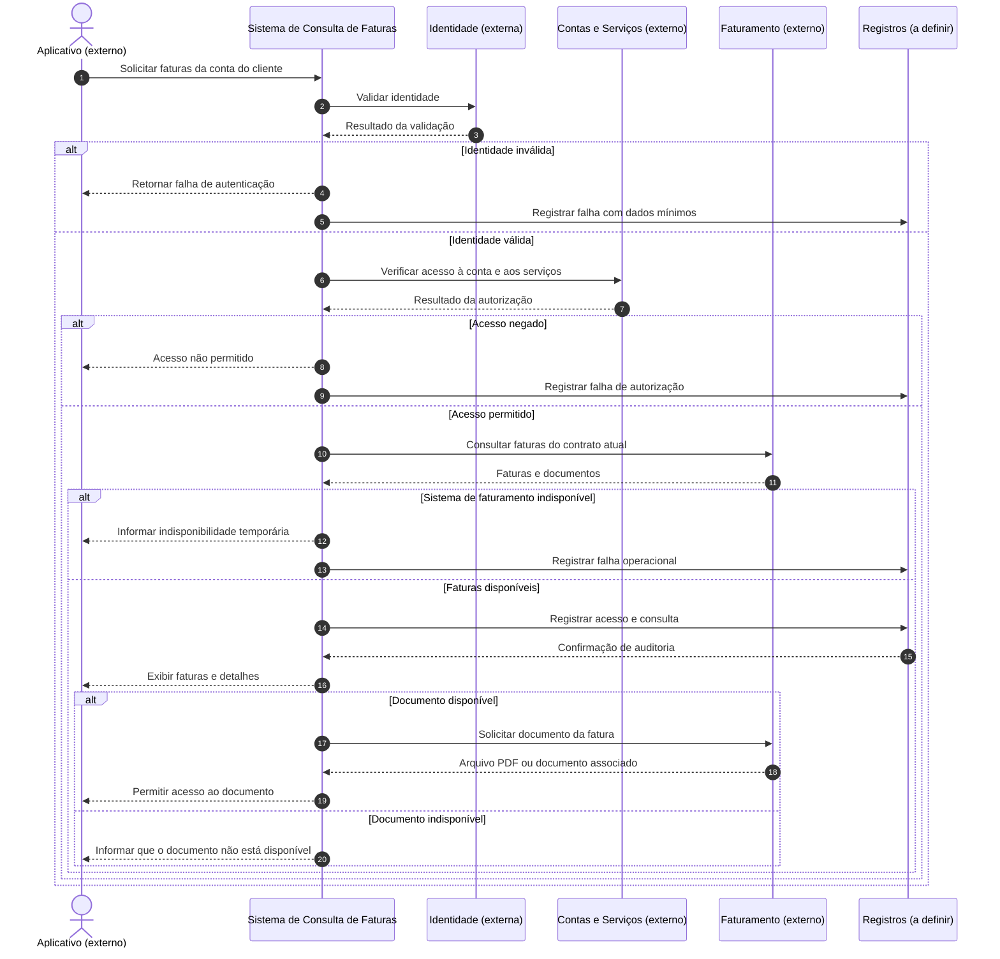

# IA-arquitetura-diagrams-as-code
Estudo para elaborar diagramas arquiteturais em código, para uso de desenvolvimento com IA

## Caso de uso: consulta de faturas no aplicativo de ecare

Este é um **cenário ilustrativo**, não uma descrição da arquitetura interna de uma empresa. A proposta é permitir que um cliente autenticado consulte suas faturas pelo aplicativo.

### 1. Escopo

O sistema permite ao cliente:
- Consultar as faturas dos serviços vinculados à sua conta.
- Visualizar competência, vencimento, valor e situação de pagamento.
- Acessar o documento da fatura, quando disponível.

**Fora do escopo:** realizar pagamentos, negociar dívidas, contestar cobranças, alterar dados cadastrais ou calcular valores de faturamento.

### 2. Nível da visão

A descrição está no **nível de contexto do sistema**, equivalente ao C4 — Nível 1.

O foco é identificar quem utiliza o sistema, suas responsabilidades e os sistemas externos com os quais se comunica. Não são definidos componentes internos, bancos de dados ou tecnologias de implementação.

### 3. Limites e responsabilidades

O **Sistema de Consulta de Faturas** recebe solicitações do aplicativo, verifica se o cliente pode acessar a conta solicitada e obtém as informações de faturamento.

Ele é responsável por:
- Disponibilizar apenas as faturas às quais o cliente tem direito de acesso.
- Apresentar informações e mensagens de erro de maneira compreensível.
- Informar quando os dados estiverem indisponíveis ou tiverem atualização defasada.
- Registrar eventos operacionais e de auditoria sem expor dados pessoais desnecessariamente.

Ele **não é responsável** por emitir faturas, calcular cobranças ou confirmar pagamentos. Essas responsabilidades pertencem aos sistemas de faturamento e financeiros, considerados externos ao sistema em estudo.

O aplicativo é o canal de interação com o cliente; o provedor de identidade autentica o usuário. A autorização para consultar uma conta deve ser validada pelo sistema, não apenas pela autenticação.

### 4. Integrações

| Integração | Finalidade | Limite de responsabilidade |
|---|---|---|
| Aplicativo da Vivo | Solicitar e apresentar as faturas | Não é a fonte oficial dos dados de cobrança. |
| Provedor de identidade | Validar a identidade e a sessão do cliente | Autenticação não substitui a autorização de acesso à conta. |
| Cadastro de clientes e contas | Identificar os vínculos entre cliente, conta e serviços | As regras para titulares e representantes precisam ser confirmadas. |
| Sistema de faturamento | Fornecer valores, vencimentos e situação das faturas | É a fonte oficial; a consulta não altera seus registros. |
| Serviço de documentos | Disponibilizar o arquivo da fatura | O acesso ao documento também deve exigir autorização. |

As integrações são descritas por sua finalidade. **Protocolos, produtos e contratos de API ainda não estão definidos.**

### 5. Restrições e premissas

Para este exercício, considere as seguintes **hipóteses a validar**:
- O sistema de faturamento é legado e não pode ser substituído neste projeto.
- A consulta deve ser somente leitura e não prejudicar a operação do faturamento.
- Pode haver aumento de acessos próximo às datas de vencimento.
- A equipe tem capacidade limitada de desenvolvimento e sustentação.
- Dados de faturamento exigem controles de segurança, privacidade e acesso, considerando LGPD e políticas internas aplicáveis.
- Uma falha na integração não pode ser apresentada como “cliente sem faturas”.
- Caso seja permitido usar dados armazenados temporariamente, a defasagem deve ser informada e respeitar um limite aprovado pelo negócio.

### 6. Lacunas a esclarecer

Antes de propor uma arquitetura, seria necessário responder:

1. **Público e contas:** o serviço atende clientes pessoa física, jurídica ou ambos? Como funcionam contas com múltiplos serviços e representantes?
2. **Volume e desempenho:** quantas consultas são esperadas e qual é o tempo de resposta aceitável?
3. **Atualização:** quanto tempo uma confirmação de pagamento pode levar para aparecer?
4. **Legado:** existem APIs disponíveis? Quais são seus limites, horários de operação e garantias de disponibilidade?
5. **Histórico e documentos:** quantos meses de faturas serão exibidos e por quanto tempo os documentos ficam disponíveis?
6. **Operação e governança:** quem responde por incidentes, quais eventos precisam de auditoria e quais políticas internas se aplicam?

## Diagramas Mermaid

Os diagramas abaixo estão embutidos diretamente no README para facilitar visualização no GitHub.

- [Diagrama de sequência](Diagrama/consulta-faturas-sequencia.mmd)
- [Diagrama de contexto](Diagrama/consulta-faturas-contexto.mmd)

### Diagrama de sequência



### Diagrama de contexto

```mermaid
flowchart LR
    subgraph A[Aplicativo (externo)]
        App[Aplicativo do cliente\nconsulta de fatura]
    end

    subgraph B[Sistema de Consulta de Faturas]
        S[Aplicação de Consulta de Faturas\n<contêiner>\nTecnologia a definir]
    end

    subgraph C[Provedor de identidade]
        Id[Identidade\n<external>]
    end

    subgraph D[Fonte de contas e serviços]
        CS[Contas e serviços\n<external>\nVínculos oficiais entre\ncliente, contas e serviços]
    end

    subgraph E[Fonte oficial de faturamento]
        F[Faturamento\n<external>\nCompetência, vencimento,\nvalor e situação de pagamento]
    end

    subgraph G[Fonte de documentos de fatura]
        Doc[Documentos de fatura\n<external>\nDocumentos quando\ndisponíveis]
    end

    App -->|Consulta faturas e acesso\na documentos autorizados| S
    S -->|Valida identidade e sessão| Id
    S -->|Verifica vínculo e acesso| CS
    S -->|Consulta faturas e dados de pagamento| F
    S -->|Obtém documentos para\nacesso autorizado| Doc

    Id -.->|Autenticação| S
    CS -.->|Autorização| S
    F -.->|Dados oficiais| S
    Doc -.->|Documentos| S

    classDef ext fill:#f2f2f2,stroke:#666,stroke-width:1px;
    classDef core fill:#e9d7f5,stroke:#8a6ab0,stroke-width:1px;
    class App,Id,CS,F,Doc ext;
    class S core;
```
